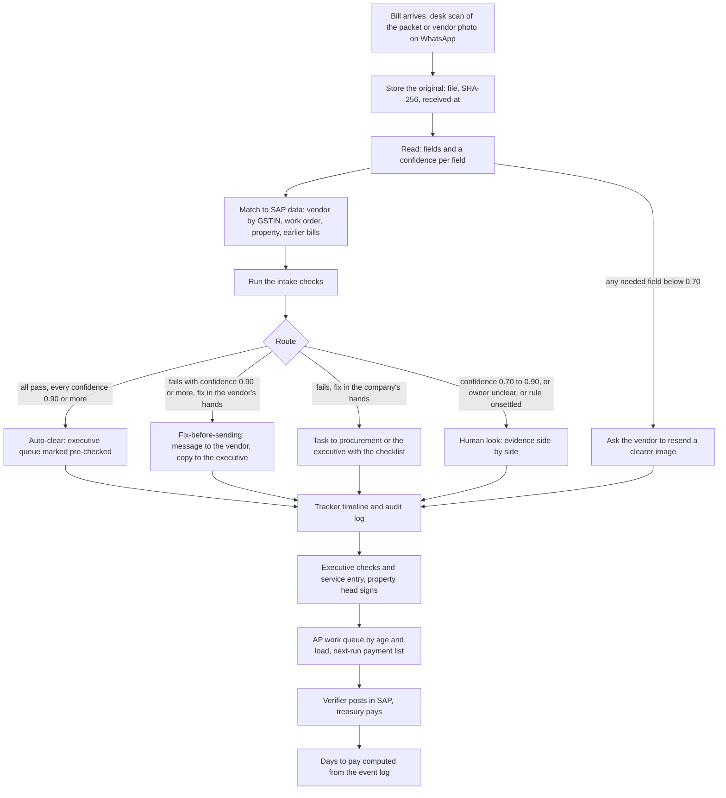

# Solution design: intake verdicts and a work queue

Scoped to what can be built by Saturday 17 October, 10 pm IST. Numbers are registered in `notes/numbers.md` (ids `d.*`, plus the ids they read). Where I read a bill myself, the note says so.

## 1. What it is, and how it relates to the options note

One product with two parts that share one data model:

- **Part A, intake verdicts.** When a bill arrives, read it, check it against the bill's own content and SAP data, decide **auto-clear, fix-before-sending or human look**, and tell the person who owns the fix in minutes, not after the packet has travelled.
- **Part B, work queue.** A live view of every bill's stage and age that orders the AP verifiers' trays, builds the next payment-run list, and sends the vendor a status message. This is where most of the days are (`notes/problem.md`).

`notes/options.md` recommended Part B (option 4b) plus a courier what-if, and argued that Part A has the lower days but is where the case's document-reading skill shows. This design builds both as one slice, because the verdict needs somewhere to land and the queue needs the verdict as its first event. They do not both fit in full: the full checker is 14.5 hours and the full queue 11.5, 26.0 together, against 14 available. Section 9 is the slice that fits.

## 2. Who uses it, and at what moment

| Moment | Person | What they see | What they do next |
|---|---|---|---|
| The vendor's bill reaches the facility desk (or a photo arrives on WhatsApp) | Facility desk | A scan screen; within a minute a verdict on the bill | Hands the packet on if clear; if a fix is asked, tells the vendor before filing |
| The verdict is ready | Vendor | A WhatsApp message with the exact fix: `GSTIN differs from our record`, `HSN/SAC missing`, `send the PF and ESIC challan` | Corrects and resends the same day (the agency owner: "if somebody had sent one WhatsApp, I would have fixed it the same evening.") |
| The executive opens the bill | Commercial executive | The bill, the verdicts with the evidence, and the work-order headroom | Confirms or overrides a human-look item; does the checks that need the paper and the service entry |
| A work order is found expired or without balance | Procurement | A task with the work order, the shortfall, and the paper to collect (RWA letter or tenant approval, budget note) | Starts the amendment on day one instead of when the service entry fails |
| The signed packet reaches head office | AP lead | A work queue ordered by age, balanced across the five verifiers | Assigns the oldest bills first, evens the load |
| A bill is posted | Treasury | The next Tuesday or Friday run list, with bills that missed the last run at the top | Pays at the next run |
| Monday morning | CFO | The twenty oldest bills, where each sits and since when | Calls the owner. "If one screen says this bill is here since this date, the argument is over." |

## 3. Data flow: bill arrival to verdict to the owner being told

**Events recorded for every bill** (the event log is the audit trail and the source of every metric): arrived, stored (hash), read (field confidences), checked (each check, its result, the data it used, the rule version), routed, notified (who, channel, text), acknowledged, fixed, executive verified, property head signed, packet sent or scanned to AP, picked, posted, assigned to a payment run, paid.

**Timing target, to be measured:** the owner is told within five minutes of the scan. The target is a design aim; the Saturday prototype will report what it actually takes.

**What the bills look like (checked by hand).** None of the 31 PDFs in the inbox has a text layer: every page is one embedded image, so no PDF can be read as text. With the nine phone photos, all 40 files need a reader that works on images. The printed fields are consistent: supplier name and GSTIN, invoice number and date, work order or PO, place of supply, HSN/SAC, rate, taxable value and tax lines. Two of the four bills I opened print 'Udyam registered: Micro', which gives a second source for MSME status where the master is blank (it is a claim by the vendor, to be verified, not proof).

## 4. The 25 checks: which run at intake, and which cannot without the paper

The property checklist has 11 checks (P1 to P11) and head office has 14 (H1 to H14). Eight pairs are the same check done twice (`notes/workflows.md` section 7); one implementation serves both.

| Class | Meaning | Checks | Queries last year |
|---|---|---|---|
| **I** | At intake, from the bill and the SAP extract | 6 | 618 |
| **X** | At intake, but needs data not in the pack | 5 | 205 |
| **PK** | Needs the rest of the packet scanned (the paper) | 8 | 242 |
| **L** | Not at intake: a later step or another source | 6 | 341 |
| none | Not tied to a checklist item (holds, bank details, hard copy) | - | 35 |

Of the 25, **6 run at intake from the bill and the SAP extract**, **5 need reference data the pack does not hold**, **8 need the rest of the packet (the attendance sheet, challans and service report) and so cannot run on a bill photo alone**, and **6 cannot run at intake at all** because they depend on a step that has not happened (service entry, signature) or on other sources (biometric, gate register, the TDS decision).

| ID | Check | Class | What it needs | Queries last year | Saturday prototype |
|---|---|---|---|---|---|
| P1 | Vendor name and GSTIN on the bill match the vendor master | I | Bill + vendor_master | 46 | yes |
| P2 | Bill is addressed to the correct company entity and property | X | Company legal entity names and GSTINs (not in the pack); the property is checkable from the work order | 12 | partly |
| P3 | Work order or purchase order number is on the bill | I | Bill; then the number must exist in SAP work orders | - | yes |
| P4 | Rate on the bill matches the work order rate | X | Work-order rates (the extract holds values, not rates); readable over RFC | 138 | no |
| P5 | Quantity, days or headcount match approved attendance or delivery | L | Biometric, gate register and the vendor claim: three sources that are not on the bill. The bill's own man-days can be tied to the attendance summary page if the packet is scanned | 17 | no |
| P6 | Attendance sheet is signed by the department head | PK | The attendance page. A signature or stamp can be detected; whose it is cannot | 51 | stretch |
| P7 | PF and ESIC challans for the previous month are attached | PK | The challan page and its month against the billing period | 52 | stretch |
| P8 | Delivery challan carries the security gate stamp | PK | The challan page; a stamp can be detected | 68 | no |
| P9 | Service report or job card is attached | PK | The service report page | 71 | no |
| P10 | Service entry or GRN is created in SAP | L | Created by the executive after the checks; status readable over RFC later | 116 | no |
| P11 | Property head has signed the packet | L | Happens after the property check; the tracker records the event | - | event only |
| H1 | Vendor GSTIN on the bill matches the vendor master | I | Same as P1; one implementation | - | yes |
| H2 | Bill is addressed to the correct company entity | X | Same as P2 | - | partly |
| H3 | Work order or purchase order is valid on the bill date and has open balance | I | Bill date and number + work_orders. Validity is exact; balance only as value headroom, because period balance and open quantity are not in the extract | 338 | yes |
| H4 | Rate matches the work order or purchase order | X | Same as P4 | - | no |
| H5 | Quantity matches the posted service entry or GRN | L | The service entry does not exist yet at intake | - | no |
| H6 | Attendance sheet is signed | PK | Same as P6 | - | stretch |
| H7 | PF and ESIC challans for the previous month are attached | PK | Same as P7 | - | stretch |
| H8 | Delivery challan is stamped | PK | Same as P8 | - | no |
| H9 | Service report is attached | PK | Same as P9 | - | no |
| H10 | GST type is correct for the place of supply | X | The company's GST registrations and a settled place-of-supply rule (not in the pack). The bill's three facts can be read and compared | 55 | partly |
| H11 | HSN or SAC code and GST rate are correct | I | Bill + a rate rule (18%; diesel carries none in the register) | 104 | yes |
| H12 | GL code and cost centre on the service entry are correct | L | The service entry does not exist yet; GL needs an expense-type mapping nobody holds | 208 | no |
| H13 | Invoice number has not been booked before for this vendor | I | Bill + posted_invoices + the register, ignoring the bill's own row | 130 | yes |
| H14 | TDS section and rate are correct | L | The section decided for each work order (not recorded) and year-to-date payments | - | no |

Reading the tables:

- **Packet checks (PK) run only if the desk scans the whole packet**, which it can, because the vendor hands it over together. A vendor's WhatsApp photo of the bill alone can only get the bill-level checks, so fix-before-sending on a photo covers class I and X only.
- **P5 is not an intake check.** The bill's man-days can be tied to the attendance summary page (in the one packet I opened both read 388), but matching against biometric and the gate register is the three-way match, which is a separate option and a separate week.
- **Queries last year by class** show where an intake check could have acted: 618 on class I items and 205 on class X. Not all of them are catchable on day one with the extract provided: only 454 of 1,441 queries (31.5%) can be, because balance, quantity and rate need SAP fields beyond the extract (`notes/query-forensics.md`).

## 5. How confidence routes a bill

**Inputs.** The reader returns a value and a confidence between 0 and 1 for each field. Each check uses some fields; the check's confidence is the lowest confidence among them, multiplied by how certain the rule itself is (1.0 for a database lookup such as GSTIN against the master, lower for a rule that is not settled, such as place of supply).

**Starting thresholds, to be tuned on the labelled bills.** 0.90 and 0.70. They are choices, not findings; there is no accuracy figure for the reader yet.

| Situation | Route | Who is told | What they see | Why |
|---|---|---|---|---|
| Every intake check passes and every confidence is 0.90 or more | **Auto-clear** | Executive (the bill appears marked pre-checked) | Nothing to resolve | It only means no intake finding. Every later check still runs |
| A check fails, confidence 0.90 or more, and the fix is the vendor's (GSTIN differs, HSN/SAC missing, wrong company name, PF/ESIC or service report page absent, rate printed as 12 where 18 applies) | **Fix-before-sending** | Vendor by WhatsApp; executive copied | The exact fix, and why | Same-day fix, not a query three weeks later |
| A check fails, confidence 0.90 or more, and the fix is the company's (work order expired, value headroom exhausted) | **Fix-before-sending, internal** | Procurement and the executive; the vendor gets a status message only | The work order, the shortfall, and the papers to collect | The amendment starts on day one; the bill is not blocked |
| Any needed confidence between 0.70 and 0.90 | **Human look** | Executive | The field image beside the value read | A person confirms a doubtful read |
| The rule is unsettled or the owner is ambiguous: place of supply against tax type; same invoice number with a different date or amount | **Human look** | Executive (AP verifier if it is a head-office item) | All the facts side by side | The law or the data does not settle it |
| A needed field is below 0.70 | **Resend** | Vendor | `Please send a clearer photo` | No verdict is better than a wrong one |

**Two bills from the inbox show why the unsettled rows exist.** In bill-11 the supplier's GSTIN is in Uttar Pradesh, the recipient GSTIN printed is a Haryana one (state code 06), the printed place of supply is Uttar Pradesh, and the tax charged is IGST. Under a recipient-location rule that is inter-State and IGST is right; under the printed place of supply it is intra-State and IGST is wrong. `notes/research.md` section 7 explains why the rule is unsettled. The check therefore **shows the three facts and routes to a human look; it does not fail the bill.** The same recipient GSTIN appears on all four bills I opened (Noida, Gurugram and Panchkula properties), which suggests one company registration across properties; the pack does not list the company's registrations.

**Sizing the human-look queue.** Each percentage point of bills sent to a human look is 104 bills a year, or 0.4 a working day on 250 days. The year's data says a finding at intake would have been available on 3.9% of paid invoices (layers A and B, 403 bills) and 8.3% if SAP also exposed work-order lines, rates and open quantity. Reader confidence will add to the human-look share; that share is the number to measure first.

**How thresholds are tuned.** By days saved per human look, not accuracy. A false auto-clear costs what a bill costs today (a query later); a false flag costs a vendor message and an executive's minutes. The labelled bills give the first estimate of the trade; the pilot gives the real one.

### Acceptance tests: four bills read by hand and joined to the pack

Printed values were read by eye from the images in `bill-inbox/` and joined to the vendor master, the work orders and the register. They are the expected results the prototype must reproduce.

| Bill | Vendor in master | Work order | Number already booked (excluding its own row) | Facts the intake checks would show | Expected route |
|---|---|---|---|---|---|
| bill-11.pdf | V10085, Garud Nirmal Landscapes Pvt Ltd, Uttar Pradesh, MSME blank | 4101752 for NOI-C32, valid on the bill date: True; approved less billed to date (this bill included) ₹38,064 | none | supplier state 09, recipient GSTIN state 06, printed place of supply Uttar Pradesh, IGST 18% | Human look: tax type against place of supply (see section 5); master MSME status blank |
| packet-01-security-manpower.pdf | V10668, Raksha Abhay Manpower Solutions Pvt Ltd, Haryana, MSME Not MSME | 4100395 for GGN-R15, valid on the bill date: True; approved less billed to date (this bill included) ₹207,804 | TRK250873 (2025-05-03, ₹199,420) | supplier state 06, recipient GSTIN state 06, printed place of supply Haryana, CGST 9% + SGST 9% | Human look: same vendor and invoice number, different date and amount |
| bill-16.jpg | V10751, Kesari Hemkunt Fire Safety Systems, Delhi, MSME Micro | 4100393 for PKL-C34, valid on the bill date: True; approved less billed to date (this bill included) ₹70,190 | none | supplier state 07, recipient GSTIN state 06, printed place of supply Haryana, IGST 18%; printed 'Udyam registered: Micro' against master 'Micro' | Auto-clear if the reader is confident |
| packet-08-repeat-invoice.pdf | V10550, Hemkunt Yamuna Facility Services, Haryana, MSME Micro | 4100602 for NOI-M38, valid on the bill date: True; approved less billed to date (this bill included) minus ₹422,500 | TRK250789 (2026-01-01, ₹172,080) | supplier state 06, recipient GSTIN state 06, printed place of supply Uttar Pradesh, IGST 18%; printed 'Udyam registered: Micro' against master 'Micro' | Human look: place of supply; the number is reused by a later bill; at the extract date the work order is past its approved value |

## 6. Controls that stay untouched

| Control | Source | What the product does |
|---|---|---|
| The original bill is filed at head office for GST audit | CFO: "The original bill has to be with us for GST audit."; policy: "Original bills and supporting documents are filed at head office" | Nothing changes when the paper travels or is filed. The product may show whether the original has arrived; it never replaces it |
| The property certifies the work | CFO: "The property must certify the work."; P6, P10, P11 | The executive still creates the service entry, the department head still signs the attendance, the property head still signs the packet. The product signs nothing and creates nothing in SAP |
| An RWA letter for work-order amendments | Procurement: "But without the RWA letter, audit will catch us." | The task asks for the letter on day one. It never waives it |
| All 25 checks still run in their present owners' hands | `notes/workflows.md` | Auto-clear means no intake finding, not approval. Head office still runs H1 to H14 |
| Posting in SAP is by a verifier | SAP extract spec | The product proposes entries in its own store. It writes nothing into SAP |
| Payment release is by treasury | Payment policy: runs on Tuesdays and Fridays | The product builds the list; treasury approves and pays |
| The TDS section for each order is the AP lead's decision | `transcripts/02-central-ap-lead.md` | The product stores her decision per work order and flags a bill that differs. It does not choose |
| Segregation: nobody can clear their own override | Audit practice | An override by a human look is logged with who, when and why |

## 7. What is simulated, and what a real connection needs

| Part | In the Saturday prototype | What a real connection needs |
|---|---|---|
| Bill intake | The 40 inbox files loaded through an upload screen, standing in for the desk scanner and WhatsApp | A desk scanner or phone app; for WhatsApp, the Business API inbound webhook. Download each file within hours (the media ID in a webhook lasts 7 days), hash it, and store it on the company side in India |
| The reader | A vision model reading the page images. Fallback: stored extractions for the labelled bills, marked simulated | A contract and data-protection terms with the model provider, cost per bill, and an accuracy report on the client's own bills |
| SAP reads | `sap_extract.sqlite`: vendor_master, work_orders, properties, posted_invoices | **RFC read access is approved.** Request work-order lines and rates, open quantity and period balance, service-entry status, and posting and payment status, which the extract lacks |
| SAP writes | Only the stand-in's `parsed_bill` table, as the extract spec allows | **Writing invoices needs a separate project with the SAP partner and audit sign-off**; the last write interface took seven to eight months to approve before any code (IT head). The product never posts, so the design does not depend on it |
| WhatsApp out | An outbox table and a preview of each message; nothing is sent | **WhatsApp Business API on a company-owned number, with files stored on the company side** (IT head), through a provider with a processing agreement. Approved templates, recorded opt-in, the 24-hour window, and DPDP notice and consent (core duties about May 2027). See `notes/research.md` section 9 |
| Audit trail | An append-only event table in the app's database: file hash, rule version, each check with its data, each notification, each human decision | A tamper-evident store in India, retention for the GST period (72 months), access and edit logs, and an export auditors can read |
| Users and roles | One local user | Single sign-on and roles for desk, executive, AP, procurement, treasury and the CFO |
| Payment runs | A replay on the register with a cut-off of 0, 1 or 2 days, and the next-run list in the work queue | Treasury's run lists, approval times and the written cut-off (`notes/payment-lag.md`); the product only proposes the list |
| Courier | A what-if switch for a second weekly or a daily courier (stretch) | The courier cost, not in the pack |

## 8. Success is days to pay, not field accuracy

**Primary measures:** (1) mean days from the desk logging the bill to payment, and from invoice date to payment; (2) the number and share of paid invoices over 45 days from the desk, and the same for known Micro and Small vendors; with the 90th percentile beside both. Baseline from the year: **31.3 days from the desk and 37.6 from the invoice date**; **1,153 paid invoices (11.0%) over 45 days** and **530 known Micro and Small invoices (10.4% of 5,106) over 45 days**; p90 47 days from the desk and 54 from the invoice date.

**Expected effect, replayed on last year's register** (part f; conditional on the people who own each lever acting, not promised). Ranges are the settings stated in section 9:

| Lever | Owner | Days off the mean |
|---|---|---|
| Pay on the first run after posting | Treasury and the AP lead (the product builds the next-run list) | 1.97 to 3.72 |
| Balanced AP pick order | AP lead (the product builds the pick order) | 1.67 |
| Three intake rules | The product, with the desk and executive acting on the verdict | 0.24 to 0.91 |
| **All three together** | | **3.94 to 6.34**, middle 4.75 |

- **Mean days from the desk:** 31.3 falls to **24.9 to 27.3**; from the invoice date 37.6 falls to 31.3 to 33.7.
- **Paid invoices over 45 days:** 1,153 falls to **447 to 653**. **Known Micro and Small over 45 days:** 530 falls to **200 to 303** (3.9% to 5.9%).
- The separate levers add up to 3.88 to 6.30 days; the combined replay gives 3.94 to 6.34, a little more, because a bill that is posted earlier can also catch an earlier run. Nothing is counted twice.
- **Where the days are:** payment-run timing and the pick order, not the intake rules. The three intake rules the register can test move the mean by 0.24 to 0.91 days. Queries still drive the tail (`notes/payment-lag.md`): 754 of the 1,153 bills over 45 days had one, and removing every query would cut at most about 3.0 days from the mean.

**Supporting measures (each from the event log):**

| Measure | Baseline | Where it comes from |
|---|---|---|
| Bills with no query (first-time-right) | 86.9% | `share.bills_with_query_pct` |
| Days a query stays open | 21.9 | query log |
| Days waiting for a verifier | 8.8 | stage times |
| Days after posting before payment | 6.0 against 2.3 if every bill made the next run | stage times and payment-run model |
| Known Micro and Small invoices late on the desk clock | 530 (10.4%); 200 to 303 with the three levers (part f) | `notes/msme-exposure.md`, replay in part f |

**What does not count as success:** field-level accuracy of the reader. It is reported as a diagnostic and used to set thresholds, and a project that raises it while the days stay the same has failed. The earlier OCR pilot closed green on accuracy and "nothing improved for the vendor" (IT head); "We measured accuracy. We did not measure days."

**Guardrails:** no rise in the query rate; no check dropped; the human-look queue never older than two working days; every override logged.

**How it would be proven in a pilot:** switch on a few properties first and compare their mean days to pay and their bills over 45 days with the others over the same weeks, from the event log. The Saturday demo shows the **replay on last year's register**, which is a counterfactual and is labelled as one.

## 9. Scope for Saturday 10 pm

Budget: 14 build hours (`notes/options.md`: 30 clock hours less sleep, life and 3 hours of slack, so the slack is already outside the 14). The slice below is **14.0 hours with nothing spare**. The spare hour of the first version (13.0 used) went to the backtest, and **the README run steps move to Sunday**, before the Monday 1 pm deadline. My estimates, not measurements.

| Part | What | Hours | First version |
|---|---|---|---|
| a | Data and event layer, tracker timeline from the register (one loader the backtest reuses) | 1.5 | 2 |
| b | Intake screen and reader on at least 10 of the 40 bills, hand-labelled for the test (build only, styling is in polish) | 3 | 3.5 |
| c | Intake checks P1/H1, P3/H3 and H13, the three-way routing, and the H11 and H10 facts | 2.5 | 3 |
| d | Owner notifications: simulated WhatsApp outbox (0.6) and in-app tasks (0.4) | 1 | 1.5 |
| e | Work queue and control tower: AP pick order (1.0), next-run payment list (0.5), MSME countdown (0.5), work-order runway view (0.5) | 2.5 | 2 |
| f | Backtest: replay three levers (payment run, pick order, three intake rules) alone and combined, with the catch table | 2 | 1 |
| UI | Design and polish of the three screens: intake (0.6), work queue and control tower (0.6), impact (0.3) | 1.5 | new |
| | **Total** | **14.0** | **13.0** |

**What paid for the new work.** The backtest took the spare hour (f 1.0 to 2.0). Design and polish (1.5) and the MSME countdown with the runway view (1.0, inside e) came out of the other parts: 0.5 each from a, b, c and d (2.0 in all), against 0.5 more in e, whose pick order and next-run list (which share one sort) drop from 2.0 to 1.5 and whose countdown and runway view add 1.0. In plain terms: the tracker timeline is a table, not a chart (a); the reader screen has no styling until polish (b); the H11 and H10 facts are shown as plain values with no explanation text (c); and the in-app tasks are a single list (d).

**Where the MSME countdown and the runway view are built: part e.** The countdown shows, for each open bill from a Micro or Small vendor, the days since the desk logged it, the days left to day 45 on the desk clock (`notes/assumptions.md`), and the Tuesday and Friday payment runs left before then. The runway view shows, for each work order, the days to its end date and the value headroom (approved less billed) against its average monthly billing. Both read the register and the work-order table loaded by part a, so no new data work is needed. They cost 0.5 hours each.

**The three screens.** Intake (parts b, c, d), work queue and control tower (part e, with the countdown and runway view), impact (part f).

**In the slice:** the intake screen and reader; checks P1/H1, P3/H3 and H13, plus H11 and the H10 facts; the three-way routing with the thresholds above; a simulated WhatsApp outbox and in-app tasks; the AP work queue with the next-run list, the MSME countdown and the runway view; the backtest; the audit event log.

**Stretch, only if ahead of plan:** presence checks for the attendance page and the PF and ESIC challans on the packets (P6, P7, H6, H7); the courier what-if switch.

**Cut, and why:** the attendance three-way match (separate option, one property and one month in the pack); the courier cost model; real WhatsApp and SAP; sign-in and roles; the vendor portal.

**Cut order if time runs short** (first item goes first). The next-run payment list and the AP pick order are protected, because the replay puts the days in payment-run timing and the pick order:

1. The in-app tasks in d (0.4 hours). The outbox stays.
2. H11 (0.3 hours inside c).
3. The H10 facts (0.4 hours inside c).
4. The work-order runway view in e (0.5 hours). My addition: the MSME countdown stays because it carries the exposure the CFO will ask about.

Never cut: part a, the routing in c, part f, the AP pick order and the next-run payment list in e. Taken in full, the order frees 1.6 hours.

**Order and checkpoints.** Friday evening: part a and the first five bills through the reader. Saturday morning: the reader on ten bills, the checks and routing. Saturday midday: notifications, then the work queue with the countdown and runway view. Saturday afternoon: the backtest (2 hours), then polish on the three screens. Freeze at 8 pm; 10 pm is the cut-off. Sunday: README run steps, deck and video.

**Decision rules.** If by Saturday noon the reader does not read at least 8 of the 10 labelled bills correctly on the fields the checks use, switch to stored extractions, mark the screen `reader simulated`, and spend the saved time on the queue and the backtest. If part c runs over, follow the cut order above. If any part has not started by 4 pm Saturday, cut it.

### Part f: replay three levers on the register

**What it does.** It replays the register (11,220 rows in `bill_register.csv`) as bills arriving on their desk dates, as if checked on that date. **Rows versus bills:** 220 rows are exact duplicates (`notes/data-audit.md` D01), so the replay uses 11,000 distinct bills, of which 10,449 are paid invoices, and the screen says so. Three levers, each alone and then all together:

1. **Pay on the first run after posting**, with the run list closing 0, 1 or 2 days before the run. A bill that was in fact paid earlier is not moved later.
2. **A balanced AP pick order:** each AP-1 bill gets the pick-up wait of the other four verifiers at the same rank in the queue, so the AP-1 mean (11.3 days) falls toward theirs (7.2 days).
3. **The three intake rules** that the register and the SAP extract can test: duplicate invoice number (H13), work order expired on the invoice date (H3), and work order value exhausted (H3, as value headroom: invoices on the order so far in desk order, above the approved value). A caught query costs a **residual delay of 1 or 3 days** instead of the 21.9 days it stayed open on average. An optimistic setting takes every layer A and B query (`notes/query-forensics.md`), removes the 2.23 days a queried bill carries beyond the days its query stays open, and leaves a 1-day residual; that setting assumes SAP fields beyond the extract.

**Combined without double counting.** Each bill's own dates move. The pick-order and intake savings bring its posting date forward (never earlier than its desk date). The payment-run lever then pays it on the first run after the new posting date, or at the old payment date less the shift, whichever is earlier. Days are therefore not added twice; the small difference from simply adding the three is shown in section 8. In the settings that apply the payment-run lever, the run is what binds. Where it is not applied, the queue and intake days assume payment follows posting at the same gap, which is the shift model, not a Treasury fact.

**What the intake rules would have caught, against the queries actually raised:**

| Rule | Query rules | Queries last year | On bills the rule flags | Not caught | Bills flagged | Flagged, never queried |
|---|---|---|---|---|---|---|
| Duplicate invoice number for the vendor (H13) | R01 | 130 | 34 | 96 | 68 | 31 |
| Work order expired on the invoice date (H3) | R26 | 107 | 102 | 5 | 690 | 506 |
| Work order value exhausted (H3, as value headroom) | R25, R24, R10 | 219 | 9 | 210 | 694 | 611 |
| **All three** | | **456** | **145** | **311** | **1,392** | |

The last column is the false-alarm load: a flag with no query is a bill someone would have looked at for nothing, or a real problem nobody raised. The backtest cannot tell which. Of 1,441 queries in all, the three rules touch 456 and the flags land on 145 of them, which is why lever 3 is small.

**Results.** Days off the mean are the same on both clocks. Counts are of the 10,449 paid invoices; Micro and Small counts are of the 5,106 known Micro and Small ones (desk clock).

| Lever | Setting | Days off the mean | Known Micro and Small over 45 days | All paid over 45 days | p90 desk to paid | p90 invoice to paid |
|---|---|---|---|---|---|---|
| Before (the year as it ran) | | | 530 (10.4%) | 1,153 | 47 | 54 |
| 1. Pay on the first run | list closes the same day (cut-off 0) | 3.72 | 370 (7.2%) | 802 | 42 | 50 |
| 1. Pay on the first run | list closes 1 day before (cut-off 1) | 2.75 | 401 (7.9%) | 868 | 43 | 51 |
| 1. Pay on the first run | list closes 2 days before (cut-off 2) | 1.97 | 430 (8.4%) | 928 | 44 | 52 |
| 2. Balanced pick order | AP-1 matched to the other four | 1.67 | 414 (8.1%) | 897 | 43 | 52 |
| 3. Three intake rules | residual delay 3 days | 0.24 | 497 (9.7%) | 1,092 | 46 | 54 |
| 3. Three intake rules | residual delay 1 day | 0.26 | 497 (9.7%) | 1,092 | 46 | 54 |
| 3. Intake, optimistic | all layer A and B queries, residual 1 day | 0.91 | 414 (8.1%) | 930 | 44 | 52 |
| **All three, low** | cut-off 2, balanced order, residual 3 | 3.94 | 303 (5.9%) | 653 | 40 | 48 |
| **All three, middle** | cut-off 1, balanced order, residual 1 | 4.75 | 288 (5.6%) | 617 | 39 | 47 |
| **All three, high** | cut-off 0, balanced order, optimistic intake | 6.34 | 200 (3.9%) | 447 | 37 | 45 |

**Reading.** Residual 1 against 3 days gives 0.26 against 0.24 days: the two differ by about 0.02 because the residual is small against the 21.9 days a caught query actually cost and only 121 bills are caught. What moves the number is how many queries the rules catch, not what a catch costs. The combined low, middle and high rows use the cut-off 2, 1 and 0 settings with residual 3, residual 1 and the optimistic intake setting.

**Confusion table, bill level.** For each rule, bills flagged on the desk date against bills that really got a query for the same cause (`backtest/out/confusion.csv`; the rate figures are of the 11,000 distinct bills).

| Rule | Flagged and queried | Flagged, not queried | Queried, not flagged | Neither | Precision | Recall |
|---|---|---|---|---|---|---|
| Duplicate invoice number for the vendor (H13) | 34 | 34 | 96 | 10,836 | 50.0% | 26.1% |
| Work order expired on the invoice date (H3) | 102 | 588 | 5 | 10,305 | 14.8% | 95.3% |
| Work order value exhausted (H3, as value headroom) | 9 | 685 | 210 | 10,096 | 1.3% | 4.1% |
| Any of the three rules | 160 | 1,232 | 296 | 9,312 | 11.5% | 35.1% |

**Rules requested but not run, and why:**

- **GST type from place of supply:** The register holds only the GST amount, not its type or the place of supply printed on the bill, and the place-of-supply reading is unsettled (notes/research.md). Needs the bill itself.
- **GSTIN match:** The register carries no GSTIN as printed on the bill: the vendor is already the master's vendor, so a match would be true by construction. Needs the bill itself.
- **MSME:** MSME status is context for the countdown, not a cause of a query, so there is nothing to catch. It enters through the MSME bills-over-45-days measure.

**AP work and vendor calls.** 87.3%: share of bills with no flag from the three rules we can test; AP still runs all other checks on these bills. Those checks are rates, quantities, service entries and attendance. **Vendor calls: 33,000 a year is a ceiling if every call were a status call that the tool removes; not an estimate.** It is the vendor survey's 3 calls per bill on 11,000 bills, an assumption; the survey does not say how many are status calls, so no lower figure is given.

**The pick-order lever is a replay on historical bills.** Each AP-1 bill is given the pick-up wait of the other four verifiers at the same rank. The live queue on 30 April 2026 holds only 27 waiting bills, so the pick order cannot repeat that saving on today's queue; it can only stop a backlog building.

**Where the backtest cannot prove anything:**

1. Counterfactual. The days saved assume a caught problem is fixed at the source in 1 or 3 days. Nothing in the register shows how fast a vendor would fix a bill, so the three settings are assumptions, not findings.
2. Three rules only. GST type, GSTIN match and MSME are not run (see NOT_RUN); the other checks need the paper, rates, quantities or service entries. The rules run touch a minority of last year's queries.
3. Final values, not day-0 values. Work-order validity and approved value are as they stand in the extract; amendments made later are not visible (data-audit D08). Value headroom is rebuilt from invoices in desk order, not from SAP's balance on the day. 'Flagged on day 0' is therefore an approximation.
4. False alarms cannot be sized. A bill that is flagged and never queried may be a real problem nobody raised or a flag with nothing behind it; the register cannot tell which.
5. Shift model. Where the payment-run lever is not applied, the pick-order and intake savings assume payment follows posting at the same gap. Payments go out on two weekdays, so this is a simplification.
6. Payment-run lever depends on Treasury. The real cut-off, approval step and funding rule are unknown (notes/payment-lag.md); the three cut-offs are settings, not a finding.
7. Pick order is a replay. It matches AP-1's historical pick-up waits to the other verifiers' on bills that are already paid. It does not show that a queue run this way would hold the same saving on a live queue.
8. Vendor calls: ceiling if every call were a status call that the tool removes; not an estimate. The survey gives about 3 calls per bill but not what share are status calls or how many a status message would remove.
9. Rows versus bills. The register has 11,220 rows, of which 220 are exact duplicates (data-audit D01); the replay uses the 11,000 distinct bills, and the rate-of-flag figures are of those.

The lever replay lives in `backtest/replay.py`; its screen data is `screen_data()` and its output is `backtest/out/impact.csv`.

**Dependencies to settle tonight (for the whole slice, not only part f).** A model API key for the reader, and whether sending the sample bills to an outside model is acceptable (they are fictional; a real client would need data-protection terms). If there is no key, the reader is simulated from the start.

## 10. Open risks

- **The reader is the one component that can fail the demo.** Nine of the forty files are phone photos, some skewed on a dark background; scanned PDFs add noise.
- **Place of supply is unsettled** (`notes/research.md` section 7), so H10 shows facts and does not decide.
- **The company's registrations and legal entity names are not in the pack**, so P2/H2 is partial.
- **The days depend on action by people** for the queue part, and on SAP fields beyond the extract for the upper end of the intake part.
