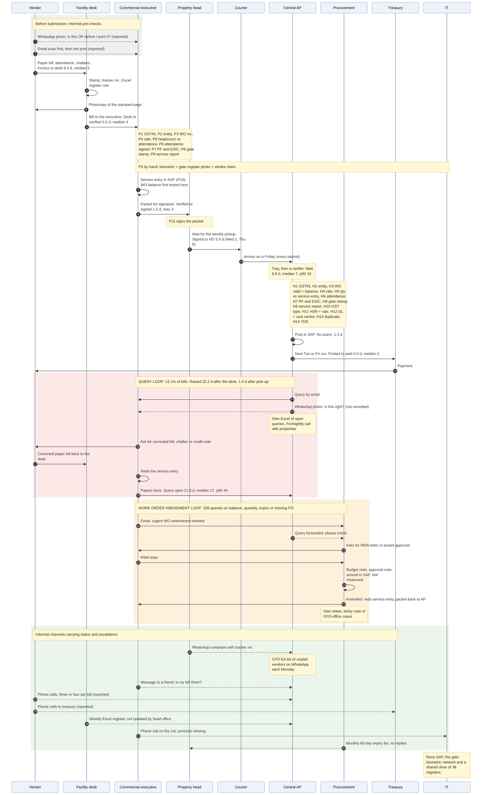
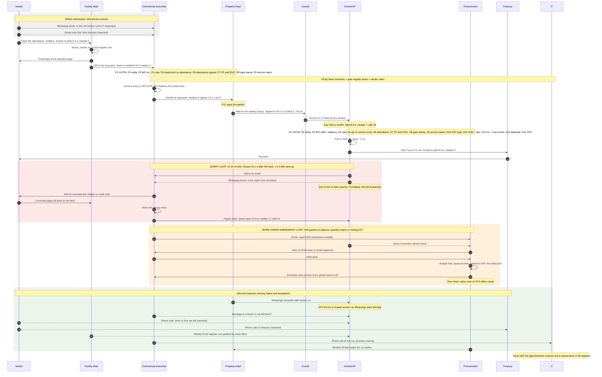

# How the workflow actually runs

Built from the seven interviews, the checklists and the data. Where the documented journey (`context/org/company-profile.md`) and what people described differ, the note shows what people described. **Measured** numbers come from the register and the query log (`notes/numbers.md`, via the scripts named at the end); **reported** statements are quotes from the interviews and are not checked against data.

## 1. Documented versus actual

| Documented step | What actually happens | Measured |
|---|---|---|
| 1. Vendor prints the bill and hands it at the desk | Vendors often WhatsApp a photo or email a scan first to check it; one trip to each property, with waits at the desk | Invoice date to desk: mean 6.4 d, median 5, p90 12 |
| 2. Desk stamps it, assigns a tracker number, logs it | Also gives the vendor a photocopy of the stamped first page so there is proof of receipt. The register is updated when the bill comes in and goes out, then never again | not separately timed |
| 3. Executive checks it and creates the service entry | For manpower, three attendance sources are matched by hand. The work-order balance is first tested when the service entry fails. The executive keeps a personal Excel and a WhatsApp group with agency supervisors | Desk to verified: mean 5.6 d, median 4, p90 11 |
| 4. Property head signs the packet | Signs on the summary and exceptions, from a folder with sticky notes for the most-called vendors | Verified to signed: mean 1.5 d, median 2, max 3 |
| 5. Packets go to head office by courier | One weekly pickup; every packet arrives on a Friday and the delay is set by the weekday of signing | Signed to received: mean 5.0 d; 2 d if signed Wednesday, 8 d if Thursday |
| 6. Central AP rechecks, then queries or posts | Not documented: the packet waits in a tray for a verifier. Then 14 checks. Queries go by email, and also by WhatsApp and phone | Wait for a verifier: mean 8.8 d, median 7, p90 16. Pick-up to posting, no query: mean 1.3 d |
| 7. Treasury pays in the next payment run | Runs are on Tuesdays and Fridays and the run list is closed ahead of each run (reported). Vendors also phone treasury directly | Posted to paid: mean 6.0 d, median 5, p90 10 |
| Not documented: the query loop | 13.1% of bills go back; the query is open a mean of 21.9 d | See section 4 |
| Not documented: the work-order amendment loop | 338 queries on work-order balance, quantity, expiry or a missing PO | See section 5 |
| Not documented: how vendors and properties learn status | WhatsApp, phone calls and one friendly verifier | reported only |

## 2. The swimlane



**How to read it.** One column per actor; time runs down the page. Solid arrows are formal hand-offs and carry the measured days for the stage they start. Dashed arrows are informal channels (WhatsApp, phone, personal Excel, email outside the register). Pink is the query loop, orange the work-order amendment loop, green the informal channels. Notes name the manual checks by checklist ID (P1 to P11 property, H1 to H14 head office). The department heads who sign attendance (P6) have no column; they sit inside the executive's step. Mermaid has no swimlane diagram, so this is a sequence diagram: lifelines for lanes, arrows for hand-offs. The source is `notes/workflows/swimlane.mmd`.

<details><summary>Mermaid source</summary>



</details>

## 3. Hand-offs and their measured days

The arrow number matches the number on the diagram. Days are calendar days for the stage that starts at the hand-off, for the paid invoices in `stage_times.csv` (`02_stage_times.py`).

| Arrow | From to | What moves, by which channel | Mean | Median | p90 | Notes |
|---|---|---|---|---|---|---|
| 3 | Vendor to desk | Paper bill with attendance and challans, by the vendor's own messenger | 6.4 | 5 | 12 | Invoice date to desk. Vendor-side time, before the company has the bill |
| 6 | Desk to executive | Bill and tracker number, in person | 5.6 | 4 | 11 | Covers all checks P1 to P9 and the service entry (P10) |
| 8 | Executive to property head | Packet in a folder on his desk | 1.5 | 2 | 3 | 75.3% signed within 2 days; 28.4% of signature dates fall on a weekend, so read with care |
| 9 | Property head to courier to AP | Weekly courier bag, no tracking | 5.0 | 5 | 8 | Fixed by weekday: minimum 2 d, maximum 8 d |
| 10 | Courier to central AP | Brown envelopes into trays | 8.8 | 7 | 16 | The wait for a verifier, the largest single wait |
| 11 | AP verification to posting | In SAP | 1.3 | 1 | | Bills with no query. With a query the bill waits in section 4 |
| 12 | AP to treasury | Posted invoice joins the run list | 6.0 | 5 | 10 | Payment runs Tuesday and Friday |
| 14 to 19 | Query loop | Email, WhatsApp, courier | 21.9 | 17 | 44 | Days the query is open, queried bills only |
| 20 to 25 | Amendment loop | Email, paper approvals | | | | **Not measured**: the data has no amendment date |

## 4. The query loop

- **Share.** 13.1% of bills (1,441 of 11,000). No bill has more than one query in the log.
- **When it is raised.** A mean 22.2 days after the desk logs the bill, 10.2 after head office receives it, and 1.0 after a verifier picks it up. The verifier finds the problem almost at once; the delay before is queue and courier time.
- **How long it stays open.** Mean 21.9 days, median 17, p90 44. After the query is resolved the bill is posted a mean 2.3 days later.
- **Channels.** Official: email to the executive, vendor copied if it is a vendor issue, noted in the register. Actual: also verifier-to-executive WhatsApp ("Unofficially, my verifiers are in WhatsApp groups with some of the commercial executives."), the AP lead's own sheet ("And I keep my own Excel of open queries, separate from the register.") and a fortnightly call ("Every two weeks we have a call with the properties to go through open queries.").
- **Where it goes wrong.** An email can reach a stale address (the agency owner's went to an accountant who had left). The corrected papers return by a channel nobody recorded. The register cannot hold a second query on the same bill.

## 5. The work-order amendment loop

- **Trigger.** Usually the executive finds out when creating the service entry ("I find out when the service entry fails.") or AP raises a query. Procurement hears by email or a forwarded query ("please check"). 338 queries fall here.
- **What an amendment needs** (procurement): a budget approval from finance if the value rises, a letter from the RWA for residential or the tenant's approval for an office tower, a signed approval note, the amendment in SAP, and then the property redoes the service entry ("If any one paper is missing, it stops.").
- **Measured.** The whole work-order query cycle closes in a median 17 days (p90 44); 41.1% close within 14 days. The amendment step itself cannot be timed.
- **Reported, and they disagree.** The executive says five weeks end to end on one case; procurement says a week once all the paper is in. Both can be true if the paper takes four weeks. Neither is in the data.
- **Warning that exists.** Procurement runs a report on the first of each month of orders ending in the next 60 days ("Honestly, I do not know if anybody opens it. Nobody has ever replied."). 93 of the 107 orders behind an expiry query would have appeared on it. It does not cover balance, which is what runs out first.

## 6. Informal channels

| Channel | Who uses it | For what | Evidence | What it replaces |
|---|---|---|---|---|
| WhatsApp group, executive and agency supervisors | Commercial executive | Attendance photos for the month's bill | "I also have a WhatsApp group with all the agency supervisors for both sites. They send attendance photos there." | The official attendance record |
| WhatsApp, vendors to executive | Vendors | Check a bill before printing | "A lot of them send a photo on WhatsApp to ask if it is fine before printing." | A bill-intake check that does not exist |
| WhatsApp, verifiers and executives | Central AP, properties | Small queries, status | "Unofficially, my verifiers are in WhatsApp groups with some of the commercial executives." | The query register |
| WhatsApp, property heads to AP lead | Property heads | Vendor complaints with the tracker number | "I forward vendor complaints to the AP lead on WhatsApp directly, with the tracker number." | A status screen |
| WhatsApp, CFO's office to AP lead | CFO's EA | Weekly list of unhappy vendors | "Every Monday she forwards it to the AP lead on WhatsApp." | A report of the oldest unpaid bills |
| Personal Excel, executive | Commercial executive | Pending bills, who she is waiting for | "My own Excel. Every bill, the date it came, what is pending, who I am waiting for. Colour coded." | A shared tracker |
| Personal Excel, AP lead | AP lead | Open queries | "And I keep my own Excel of open queries, separate from the register." | The query log |
| Personal Excel, procurement | Procurement executive | Pending amendments and what he awaits | "SAP does not tell me who has not sent the RWA letter." | An amendment tracker |
| Property Excel registers | 38 desks | The official bill log | "Thirty eight Excel files on a shared drive." | A single register; a standard template was tried and abandoned |
| Phone calls from vendors | Vendors to AP, treasury, properties | Status | "Now vendors have found the treasury number also." | Status the vendor can see |
| Email | Everyone | Official queries and amendment requests | Email can reach an old address | The record of record |
| One friendly verifier | Executives | Whether a bill reached head office | "That is my tracking system for head office. One person's kindness." | A shared status |

**Risk the IT head names:** "Bills, attendance photos, PAN cards, all on personal phones." None of it is kept under company control or logged.

## 7. Checks done twice

Eight checks appear on both checklists. In the year, head office raised **383 queries** on exactly these items (a query is raised when the first check missed something or the second disagrees). That is 383 of 1,441 queries. The earlier figure of 366 in `notes/claims-tested.md` left out the 17 bill-versus-service-entry queries.

| Property check | Head-office check | What is checked | Queries raised by head office on this item |
|---|---|---|---|
| P1 | H1 | Vendor name and GSTIN match the vendor master | 46 (GSTIN differs from vendor master) |
| P2 | H2 | Bill is addressed to the correct company entity | 12 (Wrong company name on bill) |
| P4 | H4 | Rate matches the work order or purchase order | 66 (Rate above work order rate) |
| P5 | H5 | Quantity, days or headcount match approved attendance or delivery (property); quantity matches the posted service entry (head office) | 17 (Bill amount differs from service entry) |
| P6 | H6 | Attendance sheet is signed | 51 (Attendance sheet unsigned) |
| P7 | H7 | PF and ESIC challans for the previous month are attached | 52 (PF/ESIC challan missing) |
| P8 | H8 | Delivery challan carries the gate stamp | 68 (Challan missing gate stamp) |
| P9 | H9 | Service report or job card is attached | 71 (Service report missing) |

**Why it is done twice.** Head office does not trust the property check ("I say, if I could trust you, I would not check.", AP lead; after a diesel bill whose challan belonged to another property). The property head says the signature should settle it ("If they do not trust our check, why do we do it? Either they check or we check."). Nobody has decided which of the two is the single check. The count above shows the second check does catch things; it does not show how many it re-did without finding anything, and no time is recorded for either side.

Other overlaps are partial: P3 (work order number on the bill) and H3 (work order valid, open balance) are different checks, and so are P10 (service entry created) and H5 (quantity matches it).

## 8. Checks that need information nobody has at that moment

| Check | Information it needs | Where it exists | Who has it when the check happens | Evidence |
|---|---|---|---|---|
| P3, P10, H3: work order valid and open balance | Current balance (approved value less billed, including bills in flight) and validity | SAP; read access over RFC is approved | Nobody at the desk or executive's step. The executive finds out when the service entry fails; procurement's list shows expiry, not balance | "Nobody has time to check SAP for forty work orders every week." Measured: 601 orders passed approved value; 338 work-order queries; the extract's value rule reproduces 9 of 219 balance queries |
| P5, H5: attendance and headcount | Biometric, paper gate register and the vendor claim, joined | Three separate places; the gate register cannot leave the gate | The executive, by hand, with a highlighter | In the one sample month, 11 of 17 people claim more days than biometric shows, 4 more than the gate register; 3 relievers are not in biometric at all |
| P4, H4: rate | The rate agreed by phone and not yet in the order | Nowhere recorded | Nobody: the order still holds the old rate | "The vendor sends a new rate, the property agrees on the phone, and the vendor starts billing the new rate." Measured: 66 rate-above-order queries |
| H12: GL code and cost centre | The expense type each order was meant for | Procurement's request form, filled by the property | Nobody holds a mapping from expense type to GL | Measured: 71 GL queries, 76 cost-centre queries, 61 closed-WBS queries |
| H13: invoice not booked before | Every booking for the vendor, across all 38 properties and SAP | 38 separate registers plus SAP posted invoices | AP sees SAP; each property sees only its own register | Measured: 68 vendor-and-invoice-number pairs on different bills; 130 duplicate queries, 62 of them with no twin in the register |
| H10: GST type for the place of supply | The company's GST registration for each State, and the service type | Not in the pack | Nobody at the desk; the verifier decides from the vendor's State and the property | Measured: 55 IGST queries, 39 on bills where the master says the supply is inter-State |
| H1, P1: vendor details match the master | An up-to-date master (GSTIN, bank, MSME status) | Procurement, through a shared mailbox | The mailbox, which is "not checked every day" | Measured: 137 vendors have no MSME status |
| H14: TDS section and rate | The section decided for each order, and the vendor's year-to-date payments | The AP lead's judgement, written on a note | The AP lead or the senior verifier, when asked | "Just write the work order line on the note so audit does not ask." |
| The 45-day payment rule (on neither checklist) | MSME status, the written payment term and the date of acceptance | Status partly; term and acceptance date not recorded | Nobody when treasury builds the run list | No payment-terms or acceptance-date field exists; 137 blank statuses |
| Status after the packet leaves the property | Where the packet and the bill are | Head office's receipt and the verifier's tray | Nobody outside head office. The register is not updated | "We do not get updates from head office into the register." |

## 9. What is missing: decisions and information nobody owns

| Gap | Why nobody owns it | Evidence | Measured |
|---|---|---|---|
| Watching work-order balance | Procurement watches expiry, the property finds out at the service entry, AP finds out at the query; none sees consumption against value | "Nobody tells procurement."; the monthly list is never answered | 601 orders passed approved value; 338 queries |
| Telling procurement when scope changes | The property adds guards when the RWA asks; the order is the last to know | "The order is the last one to know." | Not measured |
| Who is the single checker | Property and head office both check; no decision on which | See section 7 | 383 queries on double-checked items |
| An end-to-end bill status | The register stops at the property; head office has none; the vendor sees nothing | See section 8 | Vendors call about three times per bill (survey figure, not computed here) |
| The query log as a whole | Email, WhatsApp and three personal Excel sheets, none complete; only one query per bill is kept | See section 4 | 1,441 queries on 1,441 bills; no bill with two |
| The MSME clock | No field for the payment term or the acceptance date; the vendor master has gaps; the payment run has no MSME priority rule | `notes/research.md` sections 2 and 4 | 137 blank statuses; no field for terms |
| The TDS section for each order | Decided ad hoc by the AP lead and her senior verifier | The note-on-the-bill exchange | Not measured |
| One agreed register format | Thirty-eight versions; a locked template was tried and unlocked | IT head | 150 different property-code spellings in the merged register for 38 properties |
| Attendance as one joined view | Three sources held by three people | Section 8 | Sample month only |
| The courier schedule | Nobody owns the frequency or the cut-off; cost and who prepares packets were the objections | "Honestly, a few days here and there is not the issue." | 5.0 d mean, 8 d if signed Thursday |
| Escalation | The CFO becomes the route for every unhappy vendor, through his EA's notebook | "Every escalation comes to me and I become the post office." | Two or three calls a week (reported) |
| Whether the paper original must arrive before booking | The CFO asks the AP lead; the AP lead says nobody has asked her to change | `notes/research.md` section 6 | Not measured |
| Keeping documents sent on WhatsApp | The IT head objects; operations depend on it; no policy or logging | Section 6 | Not measured |
| Measuring days, not accuracy | The earlier OCR project closed green because it measured fields read | "We measured accuracy. We did not measure days." | See `analysis/out/stage_times.csv` |

## 10. Sources and how to reproduce

Interviews: `pack/context/transcripts/01` to `07`. Checklists: `pack/context/documents/property-checklist.md` (P1 to P11), `head-office-checklist.md` (H1 to H14). Numbers: `analysis/02_stage_times.py`, `04_query_forensics.py`, `05_claims_tested.py`, `06_msme_exposure.py`, `clean.py` and `07_workflow_map.py`, registered in `notes/numbers.md`.

```
.venv\Scripts\python.exe -I analysis\07_workflow_map.py     # writes the .mmd, this note and the figures
.venv\Scripts\python.exe -I analysis\render_mermaid.py          # renders notes/workflows/swimlane.svg
```

